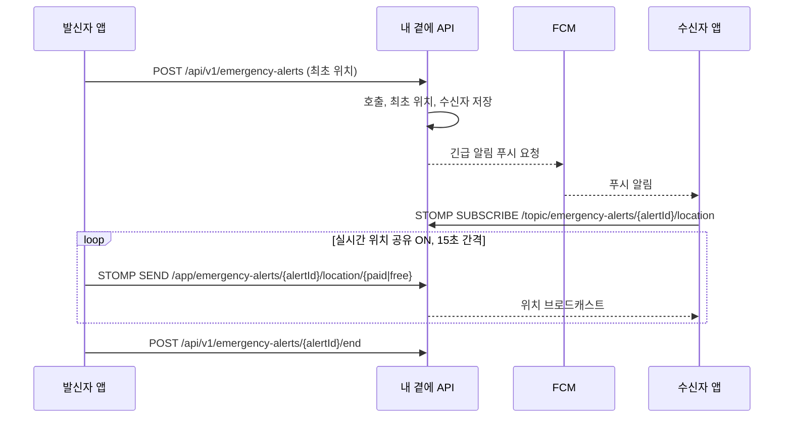
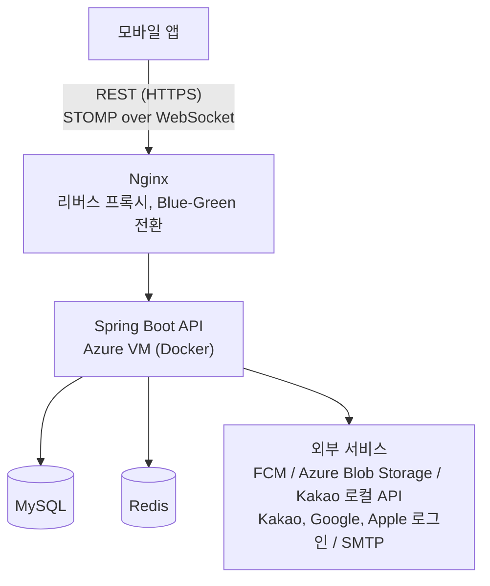

# 내 곁에 Backend

**위급한 순간, 원터치로 내 위치를 가장 믿을 수 있는 사람에게**

[](https://github.com/By-My-Side-Dev/By-My-Side-Backend/actions/workflows/deploy.yml)


[개요](#개요) | [주요 기능](#주요-기능) | [긴급 호출 흐름](#긴급-호출-흐름) | [아키텍처](#아키텍처) | [기술 스택](#기술-스택) | [API 문서](#api-문서)

**내 곁에**는 위기 상황에서 도움 요청 버튼 한 번으로 미리 연결해 둔 지인에게 긴급 알림과 현재 위치를 전달하고, 호출이 이어지는 동안 실시간 위치를 공유하는 안심 보호 서비스입니다. 이 저장소는 인증, 지인 연결, 긴급 호출, 실시간 위치 전송, 푸시 알림을 담당하는 백엔드 API 서버입니다.

> [!NOTE]
> 모바일 앱은 [By-My-Side-App](https://github.com/By-My-Side-Dev/By-My-Side-App) 저장소에서 관리합니다.

## 개요

폭력, 납치, 급박한 신체 위협 같은 상황에서는 피해자가 직접 112에 전화하거나 상황을 말로 설명하기 어렵습니다. 반면 기존 위치 공유 앱은 평상시에도 위치를 계속 수집해 사생활 침해와 배터리 소모 부담이 큽니다.

내 곁에는 다음 원칙으로 이 문제를 풉니다.

- **필요할 때만 위치 공유**: 평상시에는 위치를 수집하지 않고, 긴급 호출이 시작될 때만 위치를 전송합니다.
- **원터치 긴급 전파**: 호출 즉시 연결된 지인에게 고우선순위 FCM 푸시와 주소 정보를 보냅니다.
- **신뢰 기반 네트워크**: 초대와 수락으로 연결된 지인끼리만 호출과 위치를 주고받습니다.
- **개인정보 보호**: 전화번호와 디바이스 토큰을 암호화해 저장하고, 만료된 호출과 위치 데이터를 자동으로 정리합니다.

## 주요 기능

| 기능 | 설명 |
| --- | --- |
| 회원가입 / 로그인 | 이메일 인증 기반 일반 회원가입, 비밀번호 재설정, JWT 인증 |
| 소셜 로그인 | Kakao, Google, Apple 로그인과 신규 회원 온보딩 |
| 지인 연결 | 전화번호 기반 사용자 검색, 지인 초대(수락/거절/취소), 지인 관리, 사용자 차단 |
| 긴급 호출 | 원터치 호출 생성과 종료, 최초 위치와 역지오코딩 주소 전달 |
| 실시간 위치 공유 | 호출 중 발신자 위치를 STOMP WebSocket으로 실시간 전송, 사용자별 공유 ON/OFF |
| 수신 알림 / 지도 | 받은 긴급 알림 목록과 상세, 지도 마커와 이동 경로 조회 |
| 푸시 알림 | FCM 푸시 발송과 실패 시 재시도 |
| 마이페이지 | 프로필 조회/수정, 프로필 이미지 업로드, 회원 탈퇴 |

## 긴급 호출 흐름



- 최초 위치는 발신자의 실시간 위치 공유 설정과 관계없이 수신자에게 전달됩니다. 이후 위치는 설정이 켜져 있을 때만 전송됩니다.
- `PAID` 플랜은 위치 이력을 누적 저장해 이동 경로를 제공하고, `FREE` 플랜은 최신 위치 한 건만 유지합니다.

> [!IMPORTANT]
> 긴급 호출은 발신자가 종료하거나 생성 후 24시간이 지나면 만료됩니다. 만료된 호출에는 위치 갱신과 신규 구독이 거부되며, WebSocket 재연결로 유효기간이 연장되지 않습니다.

## 아키텍처



## 기술 스택

| 구분 | 기술 |
| --- | --- |
| Language / Framework | Java 17, Spring Boot 4.1, Spring Web MVC |
| 실시간 통신 | Spring WebSocket (STOMP) |
| Security | Spring Security, JWT (jjwt), OAuth2/OIDC 토큰 검증 |
| Database | MySQL 8.4, Spring Data JPA, Flyway |
| Cache / Session | Redis 7, Spring Session Data Redis |
| 외부 연동 | Firebase Cloud Messaging, Azure Blob Storage, Kakao 로컬 API, SMTP 메일 |
| API 문서 | Springdoc OpenAPI (Swagger UI), AsyncAPI 3.1 |
| 모니터링 | Spring Boot Actuator, Micrometer Prometheus |
| 인프라 | Docker, GitHub Actions, Azure Container Registry, Azure VM, Nginx |

### 프로젝트 구조

```text
src/main/java/com/gyeote/gyeote_api
├── domain/            # auth, user, contact, emergency, alert, location, device, notification
└── global/            # auth, config, exception, response, security, storage, websocket

src/main/resources
├── application*.yaml  # 공통 / local / prod 설정
└── db/migration/      # Flyway 마이그레이션 SQL

docs/asyncapi.yaml     # STOMP WebSocket API 명세
```

## API 문서

| 문서 | 경로 |
| --- | --- |
| REST API (Swagger UI) | `/swagger-ui/index.html` |
| STOMP WebSocket API | `/asyncapi/` |
| AsyncAPI 원본 | [`docs/asyncapi.yaml`](docs/asyncapi.yaml) |
| 헬스 체크 | `/health` |

> [!TIP]
> AsyncAPI HTML 문서는 Node.js 환경에서 `./script/generate-asyncapi-docs.sh`로 다시 생성할 수 있습니다.

## 팀

| 역할 | 이름 |
| --- | --- |
| Frontend / PM | 오영일 |
| Backend | 손세영 |
